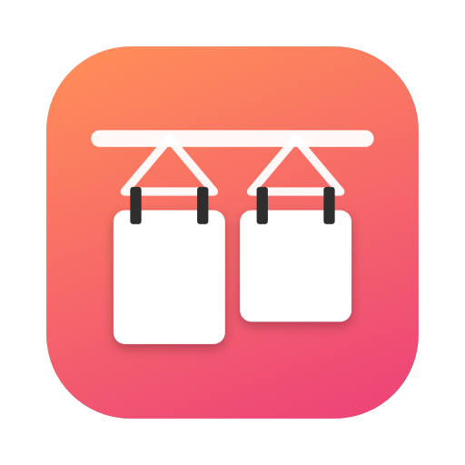
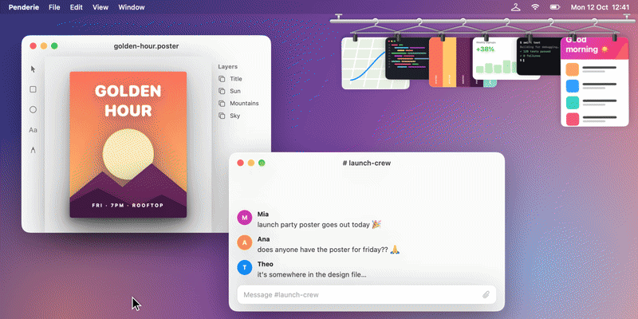

<div align="center">



# Penderie

**Your screenshots, hung up where you can reach them.**

*penderie* (n., French) — a wardrobe. The rail you hang things on so you can grab them later.




</div>

---

## The problem

You hit <kbd>⌘</kbd><kbd>⇧</kbd><kbd>4</kbd>. A little thumbnail appears in the corner.
You switch windows to paste it somewhere…

…and it's gone. Buried somewhere in your Desktop pile, named `Screenshot 2026-10-12 at 12.41.07.png`.

Most screenshots are taken to be **used right away**: dropped into a chat, a doc, an issue, a prompt. Five seconds isn't enough.

## The fix

Penderie hangs every new screenshot on a little chrome rail in the top-right corner of your screen.
**They stay there**, floating above every app and every Space, until you drag them somewhere or take them off.

- 🧥 **Hangs, swings, settles.** Each capture drops onto its own hanger with real pendulum physics.
- 👋 **Brush past them.** Hover the rail and the cards sway. When it's crowded, the one under your cursor slides out, just like flipping through a wardrobe.
- 🫳 **Drag it anywhere.** Slack, Messages, Mail, Figma, Chrome, a ChatGPT/Claude prompt, Finder… Once it lands, it comes off the rail.
- ✕ **Take it off** with the glass close button, or clear the whole rail.
- 🎬 **Screen recordings too.** `.mov` captures get a play badge.
- 🪟 **Never steals focus.** The rail is a non-activating panel: the app you're in stays in front, and clicks on empty space go straight through.
- 💾 **Remembers** what's hanging across restarts. Delete a file from disk and it quietly falls off the rail.
- 🍃 **~0% CPU when idle.** File-system events, no polling, no network.

## Install

You need **macOS 26 (Tahoe)** and Apple's command line tools (`xcode-select --install`). Full Xcode isn't required.

```bash
git clone https://github.com/mehdibenbra15/penderie.git
cd penderie
./build.sh --install
```

That compiles the app, copies it to `/Applications`, and launches it. Look for the 🪝 hanger in your menu bar.

On first launch, macOS asks whether Penderie may access your **Desktop** (or wherever your screenshots are saved). Say yes: that's how it sees new captures.

> **Tip: turn on Instant Mode.** By default macOS waits ~5 s (while it shows its own floating thumbnail) before it actually writes the file.
> Menu bar 🪝 → **Instant Mode** turns that thumbnail off, so captures hit the rail immediately.

## Using it

| Do this | To |
|---|---|
| Take a screenshot (<kbd>⌘⇧3</kbd> / <kbd>⌘⇧4</kbd> / <kbd>⌘⇧5</kbd>) | Hang it on the rail |
| **Drag** a card out | Drop the file into any app (copy, the original stays put) |
| **Click** a card | Open it in Preview to mark it up |
| Hover → **✕** | Take it off the rail (the file is untouched) |
| **Right-click** a card | Copy · Open · Show in Finder · Take Off Rack · Move to Trash |
| Hover the rail → **Clear** | Take everything off |

### Menu bar options

- **Take Off After Drop**: on by default. Turn it off to keep cards hanging after you use them.
- **Clink When Hung**: a tiny hanger *tink* when a capture arrives.
- **Instant Mode**: hide macOS's own preview thumbnail so captures appear instantly (see above).
- **Open at Login**

## Privacy & safety

Penderie is ~1,000 lines of Swift with zero dependencies, so you can read all of it in one sitting.

- **No network access at all.** No analytics, no telemetry, no update checks.
- **It never deletes or moves your files.** Dragging out offers a *copy* only. The single destructive action is *Move to Trash* in the right-click menu, and that's recoverable.
- **It only reads its own folder:** your screenshot folder (`⌘⇧5 › Options › Save to`, `~/Desktop` by default). It only reacts to new image or video files that macOS tagged as screen captures, or that are named like one.
- **What it stores:** the list of file paths currently on the rail, in `~/Library/Preferences/local.penderie.plist`.
- **The one system setting it touches:** *Instant Mode* flips `com.apple.screencapture show-thumbnail`, and only when you click it. Undo it from the same menu, or with `defaults delete com.apple.screencapture show-thumbnail`.
- **Not sandboxed**, because it has to read whichever folder you save screenshots to. macOS still asks your permission for protected folders like Desktop and Documents.

## FAQ

**My screenshots don't show up.**
Check the 🪝 menu: if it says *Allow access to Desktop…*, click it and enable Penderie under *Files & Folders*. If you rebuild from source, macOS sees a new app and may ask again.

**Screenshots copied to the clipboard (<kbd>⌃⌘⇧4</kbd>) don't appear.**
Right: those never become files, so there's nothing to hang. Use the regular shortcuts.

**I dragged macOS's floating thumbnail somewhere and it never reached the rail.**
When you grab that thumbnail, macOS doesn't save the file at all. Turn on **Instant Mode** and drag from the rail instead.

**Uninstall?**
Quit from the menu bar, then:
```bash
rm -rf /Applications/Penderie.app && defaults delete local.penderie
```

## Hacking on it

```
Sources/
  App.swift             app delegate, floating panel, menu bar, click-through
  Rack.swift            model: layout, hover/flip logic, pendulum physics
  RackView.swift        SwiftUI: rail, hangers, cards, glass buttons
  RackInputView.swift   AppKit layer: clicks, drag-out, context menu
  Watcher.swift         FSEvents watcher + QuickLook thumbnails
scripts/
  make-demo.sh          re-renders docs/demo.gif, demo.mp4 and hero.png
```

`./build.sh` builds into `build/Penderie.app`. The README demo is rendered offscreen from the real `RackView` with fake windows and fake screenshots (`scripts/demo/main.swift`). Re-run `./scripts/make-demo.sh` after visual changes (needs `ffmpeg`).

PRs welcome, especially ones that make it more fun.

## License

[MIT](LICENSE)
